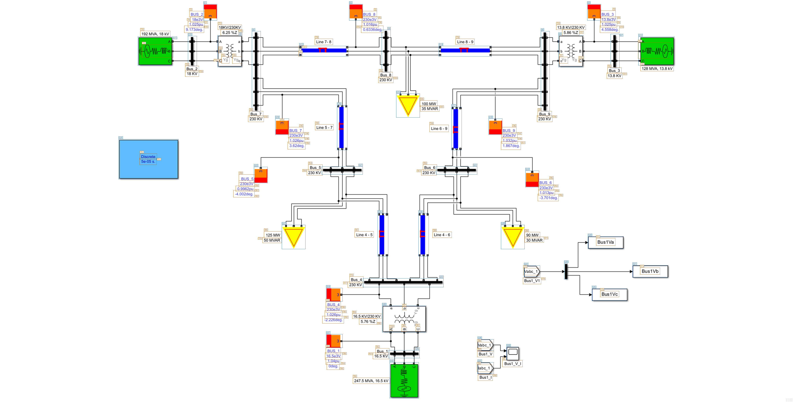

# IEEE9 image annotation example

Annotate [IEEE9.bmp](IEEE9.bmp) with local YOLO + RapidOCR.

Run from the repository root:

```cmd
annotate-image.cmd "docs\examples\IEEE9\IEEE9.bmp" "%TEMP%\easy-uiauto-ieee9" --profile block-diagram
```

The example detects **42 graphics and 102 text regions**. Blue `G` labels identify
graphics; orange `T` labels identify text.



Results: [graphics](results/controls.png), [text](results/text.preview.png),
[coordinates JSON](results/elements.json), [coordinates CSV](results/elements.csv).
Download the example and open [results/index.html](results/index.html) locally
for the interactive viewer.
