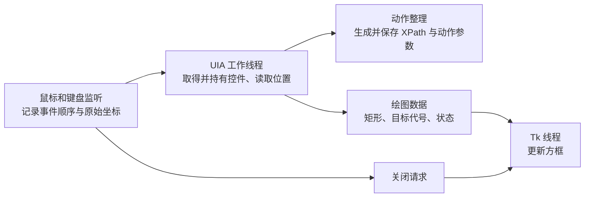

录制与高亮调整方案（待实施）

日期：2026-10-28。基线：v0.9.6，提交 `23ce0dd`。用户已确认该基线实际录制可用；本方案第一轮的退出清理、错误恢复和队列处理已调整代码，尚未运行测试或桌面实测。UIA 线程归属的后续架构调整仍暂缓。

建议先在现有同进程、独立 Tk 线程的实现上补齐退出清理、错误恢复和队列处理。UIA 线程归属调整作为后续独立工作，以具体故障和真实应用验收决定是否启用。

目前的录制路径是：鼠标回调取得控件及 XPath，动作数据进入录制结果，控件通过队列交给 Tk 线程持续跟踪。保留这条已实测通过的路径，可以让第一轮修改集中在可定位的边界问题上。

| 旧方案的问题 | 调整依据 |
| --- | --- |
| v0.9.3 高亮依赖子进程再次解析 XPath | 已取得的控件不应为了显示方框再经历一遍窗口和层级查找。v0.9.6 已去掉这一步。 |
| UIA 查找在子进程 Tk 回调中同步执行 | 子进程并不能保证绘图响应；调用阻塞仍会挡住绘图和关闭命令。 |
| 一次查找失败被保存为永久错误，后续发送也失败 | 目标暂时失效应允许下一次选择恢复，错误应能被看到。 |
| `-I` 隐藏用户级 site-packages | 同进程高亮直接使用当前解释器环境，省去这项启动兼容性负担。 |
| 固定矩形和进程启停验证绕过实际控件跟踪 | 验收必须观察真实控件的选择、移动、切换、消失和退出。 |

以上是旧实现中能够确认的机制问题；历史上某一次失败由哪一项触发，需要对应运行日志才能进一步确定。

第一轮按下面三个独立改动实施，便于出现回归时只回退对应改动。

1. 补齐启动与退出清理。

   修改 `src/easy_uiauto/record.py` 的 `start_ui_thread()`、`stop()` 和 Tk 线程结束处理。

   - 仅在 `ui_thread.ident is not None` 且不是当前线程时执行 `join()`，与现有监听器的启动检查保持一致。
   - 将 `_stop_complete.set()` 放入覆盖整个清理阶段的最外层 `finally`。它表示清理流程已经结束，清理是否成功仍由错误状态说明。
   - 保留最初的启动或录制错误；清理错误另行累积，避免次生的 `join` 错误盖住原始原因。
   - 关闭信号只发起一次，重复 ESC 或重复 `stop()` 不重复推送动作、不重复调用结束回调。
   - 将关闭请求提早交给 Tk 线程，Tk 的窗口、定时回调和对象释放仍全部在该线程完成。保留当前结束回调的含义，不将其误称为所有资源均已释放的证明。
   - 跟踪并取消队列 `pump()` 的 `after` 句柄，配合已有的 `_tick_after_id`，处理启动到一半失败、正常关闭和异常退出。

   原因：当前 `ui_thread` 已创建但 `start()` 失败时，仍可能 join 未启动线程；该异常还会跳过完成信号。定时回调的取消则让退出顺序明确，避免窗口销毁后仍有绘图回调。

2. 让高亮失败可以恢复，并保留原因。

   修改 `record.py` 的高亮命令处理，以及 `src/easy_uiauto/draw.py` 的绘图回调错误边界。

   - 区分启动错误、单次目标更新失败和绘图线程退出。启动错误继续明确返回失败；单次目标失败记录警告，允许后续目标正常更新；绘图线程意外退出必须向录制管理线程报告。
   - 控件读取失败时采用当前丢失状态的显示行为，避免将上一个有效矩形当作新目标成功。下一次目标读取成功后清除当前目标的警告状态，保留错误历史。
   - 对队列入队、样式更新和绘图回调中的异常提供有范围的处理。预期的关闭异常可以结束清理，运行中的异常需要记录原因，不能全部静默忽略。
   - 单次更新异常后，在窗口仍有效且未请求关闭时继续安排下一次回调；已经销毁的 Tk 对象不再安排回调。
   - 相同目标、相同错误只记录首次及累计次数，成功恢复时再记录一次，避免按 50 ms 周期刷屏。
   - 高亮不可用时保留已经录制的动作，明确报告高亮中断。鼠标或键盘监听失败仍属于录制失败，沿用错误传播机制。

   原因：高亮反馈和动作采集需要分别报告状态。当前能录到动作，不能被描述成方框跟踪也正常；某一次显示失败，也不应永久拒绝之后的显示更新。

   这一改动保留 `run_record(write_file=...)` 的调用方式、返回列表、动作结构和现有颜色含义。先使用内部状态和现有消息输出，不增加一套公共 API。

3. 控制高亮队列的处理量，让关闭请求及时生效。

   修改 `record.py` 的队列消费方式。

   - 每次 pump 处理有限数量的命令，然后把执行权交回 Tk。第一版可采用最多 32 条，先保留现有 16 ms 调度周期。
   - 对同一批连续的目标切换只显示最后一个目标；样式命令按原有顺序处理。合并仅作用于显示队列，动作数据中的点击、双击和拖拽记录完整保留。
   - 使用独立的关闭请求标志，在每批处理之前、每条命令之间检查。关闭请求到达后不再处理过期显示更新。
   - 保留当前 50 ms 控件跟踪间隔；记录队列等待、矩形读取、绘图和关闭耗时后再决定是否调频率。

   原因：当前 `while True` 持续清空队列，命令持续到达时会挤占 Tk 的绘图时间。显示最新目标即可满足反馈需求，而录制结果仍需要完整的动作顺序。

   数量上限和关闭标志只能限制正常命令调度。一条已经进入 UIA 的底层调用如果挂住，线程等待超时不能中断它；这一轮不能声称已解决所有 UIA 卡死。

UIA 跨线程问题需要单独决策。当前鼠标线程创建的 `Control` 被 Tk 线程读取，存在库明确提示的线程归属风险；用户已实测可用，尚未取得当前版本由此失败的复现证据。仅在 Tk 线程补 `CoInitialize()`，并不能证明跨线程使用已有控件对象变得正确。

若后续确认需要解决这一问题，建议采用同进程内的专用 UIA 线程：

这一步的具体约束如下：

- UIA 工作线程在整个生命周期内初始化 COM，在同一线程创建、读取和释放控件。首次识别仍以事件坐标为入口，随后跟踪该线程持有的控件；每次绘图不重新解析 XPath。
- 控件身份属于 UIA 线程；Tk 只接收数值和字符串，例如 `target_id`、矩形、时间戳以及正常、遮挡或丢失状态。Tk 不再调用 `BoundingRectangle`、`GetParentControl` 等 UIA 接口。
- 矩形持续从同一个目标读取，支持窗口移动、滚动和控件尺寸变化。不能只传一次矩形就把实时跟踪变成静态方框。
- 目标代号用来丢弃过期结果，避免上一个目标较慢的读取结果覆盖新目标。实际动作事件按统一序号整理，不能因异步处理改变点击、输入和拖拽的先后关系。
- 录制使用的 XPath 与绘图数据分别输出；XPath 是保存和后续回放所需的数据，高亮获得矩形后即可更新。
- 瞬时菜单是这一步的关键风险：事件进入队列后再按坐标取控件，界面可能已经变化。因此必须观察真实菜单等短暂控件；若出现错选或漏录，这一方案就不能替代现有默认路径。
- 同进程线程无法保证取消永久阻塞的 COM 调用。UIA 线程失去响应时必须报告采集停滞，不能将线程等待结束描述为底层调用已经终止。

实施前先记录发生异常的线程、目标代号、操作阶段、耗时和异常类型，用这些证据确认问题属于跨线程访问、目标已销毁、队列积压还是 UIA 提供方阻塞。该架构调整应独立提交和验收，第一轮修补不依赖它完成。

后续验收标准如下，供实际验证时使用。本次实现后仅做静态检查，不运行测试；继续遵守用户此前暂停测试的要求。

| 场景 | 应观察到的结果 | 用途 |
| --- | --- | --- |
| 在用户实际使用的 Python/PyCharm 环境启动 | 正常开始录制并出现高亮；失败时能看到原始原因 | 覆盖真实安装环境 |
| 点击不同真实控件，移动窗口并滚动 | 方框跟随当前控件，动作里的目标正确 | 证明实时跟踪可用 |
| 菜单弹出后立即选择菜单项 | 录到的是当时选择的菜单项 | 发现异步定位的时序问题 |
| 单次点击、双击、右击、拖拽、输入、组合键 | 动作类型和顺序与操作一致 | 避免只验证显示 |
| 快速切换控件 | 方框最终落到最新目标，动作记录完整 | 验证显示合并与录制的区别 |
| 当前控件被关闭，再选择其他控件 | 记录一次失效，随后恢复高亮 | 验证错误恢复 |
| ESC、重复 stop、启动中途失败 | 不 join 未启动线程，完成信号可靠，原始错误保留 | 验证退出边界 |
| 正常退出后再次启动 | 没有遗留方框或销毁后的 Tk 回调错误 | 验证生命周期 |

固定矩形、模拟对象和简单窗口只能证明局部行为，不能替代上表中的真实控件验收。这里的验收标准是后续要求，不是已完成结果；本方案也不承诺尚未测量的延迟数字。

第一轮主要修改范围为 `src/easy_uiauto/record.py` 和 `src/easy_uiauto/draw.py`。保留 v0.9.6 的同进程跟踪、穿透点击、禁止抢焦点、遮挡判断、录制输出和对外接口。`highlight.py`、`_highlight_worker.py` 当前已不在录制调用路径中，暂时保留，后续确认外部使用情况后再决定是否移除。

本次已实现第一轮“清理 → 错误恢复 → 队列处理”，并保留现有同进程控件跟踪方式，纳入 v0.9.7。按用户要求未运行本地测试或桌面实测，运行效果仍待实际验证。
